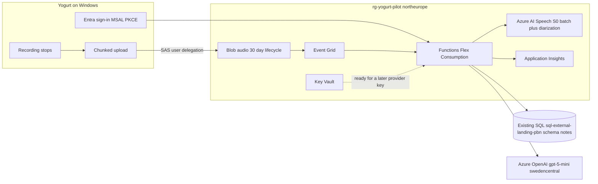

# Preferred by Nature cloud pilot

Five people can record a meeting in Yogurt, sign in with their work account, and get a transcript and summary without downloading a speech or notes model. On-device notes stay the default. Cloud mode turns on only with a setting or `YOGURT_CLOUD=1`. `YOGURT_CLOUD=0` forces on-device notes.

Nothing in this setup is deployed into `rg-dat-bui-asana`. The existing SQL server stays there.

## Where it runs

| | |
| --- | --- |
| Subscription | MSAzureCredit `18221f37-3034-427f-a822-284fa053a35d` |
| Tenant | `6a94fd93-b4dc-42db-9712-8defab2a3e93` |
| Resource group created | `rg-yogurt-pilot` in **North Europe** (`northeurope`) |
| SQL (existing, not created) | server `sql-external-landing-pbn`, resource group `rg-dat-bui-asana`. Pass the database name and, if that server is in another subscription, its subscription id. |

Azure AI Speech batch transcription, with diarization, is available in North Europe, so the Speech resource is created there. Audio stays in the North Europe storage account.

**gpt-5-mini is not offered as a Global Standard deployment in North Europe.** The OpenAI account and the `gpt-5-mini` deployment (model version `2025-08-07`) are created in **Sweden Central** (`swedencentral`), which does offer Global Standard. Only the transcript text is sent there for the summary. If a deployment error says Speech cannot be created in North Europe, rerun with `-SpeechLocation swedencentral`.



The desktop app never holds a Speech key or an OpenAI key. It sends the Entra access token to the function. The function uses its managed identity for Blob, Speech, OpenAI and SQL. There is no application secret in this pilot. Key Vault is still created, and the function identity can read secrets, so a later Claude or OpenAI key can be stored there without putting it in the app. Application Insights uses its connection string in the function settings because writing that string into Key Vault in the same deployment races role-assignment propagation.

## Cost

About **$41 a month** for the shape below. The existing SQL database is not included.

| Piece | Estimate |
| --- | --- |
| Speech batch transcription | $0.18 per hour × ~217 hours ≈ $39 |
| GPT-5 mini summaries | ~$1.50 |
| Blob storage for audio | ~$0.30 |
| Functions Flex (scale to zero), Event Grid, App Insights 5 GB, Key Vault operations | free tier for this volume |

217 hours is the planning figure for the five people, not a cap. Audio is deleted 30 days after it was written. Global Standard GPT-5 mini bills per token. The Sweden Central hop is a few kilobytes of transcript per meeting and does not change this estimate.

## 1. Two Entra app registrations

You need Application Administrator (or a similar role that can register apps and grant consent) in tenant `6a94fd93-b4dc-42db-9712-8defab2a3e93`.

`cloud/deploy.ps1 -CreateEntraApps` does this. It creates:

1. **Yogurt Pilot Desktop**, a public client. Redirect URI `http://localhost` (any port). Used by MSAL in the Electron app with the authorization code and PKCE. No client secret.
2. **Yogurt Pilot API**. Application ID URI `api://<api-app-id>`, access token version 2, delegated scope `access_as_user`. The desktop app is preauthorized for that scope, and admin consent is requested.
3. A security group **Yogurt Pilot**. Both enterprise apps require assignment, and the group is assigned. Only members get tokens.

To add someone by hand: Microsoft Entra ID → Groups → Yogurt Pilot → Members. Or pass `-PilotUserUpns user@pbn.org` (up to the five people) on the deploy script.

The API checks the token's tenant, audience (`api://<api-app-id>`), scope `access_as_user`, and the desktop client id. Row-level security in SQL then limits each person to their own object id.

## 2. Deploy

On a Windows machine with the [Azure CLI](https://learn.microsoft.com/cli/azure/install-azure-cli), Node.js and pnpm:

```powershell
az login --tenant 6a94fd93-b4dc-42db-9712-8defab2a3e93
pwsh -File cloud/deploy.ps1 -SqlDatabaseName YOUR_DATABASE -CreateEntraApps -PilotUserUpns user1@pbn.org,user2@pbn.org,user3@pbn.org,user4@pbn.org,user5@pbn.org
```

If the SQL server is not in MSAzureCredit, pass `-SqlSubscriptionId` as well. The script still only creates `rg-yogurt-pilot`. It will refuse to deploy if the target resource group is `rg-dat-bui-asana`.

The script:

1. Creates `rg-yogurt-pilot` in North Europe.
2. Deploys `cloud/infra/main.bicep`: Flex Consumption function app, storage account and `audio` container, 30-day blob lifecycle, Key Vault, Speech S0, Azure OpenAI with `gpt-5-mini` in Sweden Central, Application Insights, and the managed-identity role assignments.
3. Builds and zip-deploys the function with `az functionapp deployment source config-zip`.
4. Deploys again with the Event Grid subscription, now that the `onAudioBlob` function exists.
5. Prints the values the desktop app needs, and the two SQL statements that grant the function identity.

`gpt-5-mini` sometimes still requires the subscription to be allowed to deploy it. If the deployment fails on the model, enable it in Azure AI Foundry and run the script again.

## 3. SQL migration

Connect to the **existing** database on `sql-external-landing-pbn` as a Microsoft Entra admin (Azure Data Studio or `sqlcmd`). Run [`cloud/sql/001_notes.sql`](../cloud/sql/001_notes.sql). It creates schema `notes` with `meetings`, `transcripts`, `summaries` and `action_items`, keyed by the Entra object id, and turns on row-level security.

Then run the two statements the deploy script printed, with the real function name:

```sql
CREATE USER [func-yogurt-pilot] FROM EXTERNAL PROVIDER;
ALTER ROLE notes_app ADD MEMBER [func-yogurt-pilot];
```

Do not add that user to `db_owner`. Owners skip row-level security. On the SQL server firewall, allow Azure services to connect. The script does not change the firewall or anything else in `rg-dat-bui-asana`.

The HTTP API sets `SESSION_CONTEXT` `user_oid` and clears `bypass`, and every query also filters on `user_oid`. The timer that finishes transcription sets `bypass = worker` so it can see every in-progress meeting, then writes each row with that meeting's object id.

## 4. Configure Yogurt

Cloud mode does not download the local whisper or notes models. Restart after changing it.

Either set user environment variables:

```text
YOGURT_CLOUD=1
YOGURT_ENTRA_TENANT_ID=6a94fd93-b4dc-42db-9712-8defab2a3e93
YOGURT_ENTRA_CLIENT_ID=<desktop app id>
YOGURT_ENTRA_API_SCOPE=api://<api app id>/access_as_user
YOGURT_CLOUD_API_URL=https://<function>.azurewebsites.net/api
```

Or the same fields in `%APPDATA%\Yogurt\settings.json` (`cloudMode`, `cloudTenantId`, `cloudClientId`, `cloudApiScope`, `cloudApiUrl`). Environment variables win. These are not secrets.

Sign in from Settings → Cloud notes. The app opens the system browser, receives the code on `localhost`, and stores the MSAL cache with Windows DPAPI (`safeStorage`). The access token is refreshed silently. Sign out clears the cache. While cloud mode is on, stopping a recording uploads `me` and `them` in 4 MB blocks, resumes blocks that already landed, and retries when the network is down. The meeting view then shows the transcript and the summary the API stored. Generate summary runs the summary again. The summary model is chosen on the server (`SUMMARY_PROVIDER`, default `azure-openai-gpt-5-mini`). `claude` and `openai` are the later swaps and are refused until a provider is added.

`YOGURT_FAKE=1` is unchanged and does not turn cloud mode on.

## 5. Unsigned Windows installer

GitHub can build it. Open Actions → **Pilot Windows installer** → **Run workflow** on `main`. That workflow is manual only: it does not run on push, is not part of the release workflow, and does not sign or publish. The installer is an artifact on the run (`Yogurt-windows-x64`). The form is filled with the pilot tenant, desktop client, API scope and `https://func-yogurt-pilot.azurewebsites.net/api`. Those values are written into the app at build time, so cloud mode is on after install. A repository variable of the same name (`YOGURT_ENTRA_TENANT_ID`, `YOGURT_ENTRA_CLIENT_ID`, `YOGURT_ENTRA_API_SCOPE`, `YOGURT_CLOUD_API_URL`) overrides the form. They are not secrets.

To build it yourself on a Windows machine, from the repo:

```powershell
pnpm install
pnpm -C app native
pnpm -C app build
pnpm -C app exec electron-builder --win
```

The installer is `app\dist\Yogurt-windows-x64.exe`. It is unsigned. SmartScreen will warn the five people; they choose More info → Run anyway. Installed copies look for updates on `syahdeini/yogurt` (see `publish` in `app/electron-builder.yml`). Signing workflows are unchanged.

Give each person the installer, put them in the Yogurt Pilot group, and give them the five configuration values above. Each person signs in with their own work account. They only see their own meetings.

## What the function does

`POST /api/meetings` checks the Entra token and returns a user-delegation SAS (managed identity, no account key). The app uploads the block blob. Event Grid `Microsoft.Storage.BlobCreated` starts Azure AI Speech batch transcription with diarization. A timer finishes the job, asks GPT-5 mini for notes and action items, and stores them in `notes`. `GET /api/meetings/{id}` returns that person's transcript and summary. `POST /api/meetings/{id}/summarize` writes the notes again, including a rewrite instruction.
